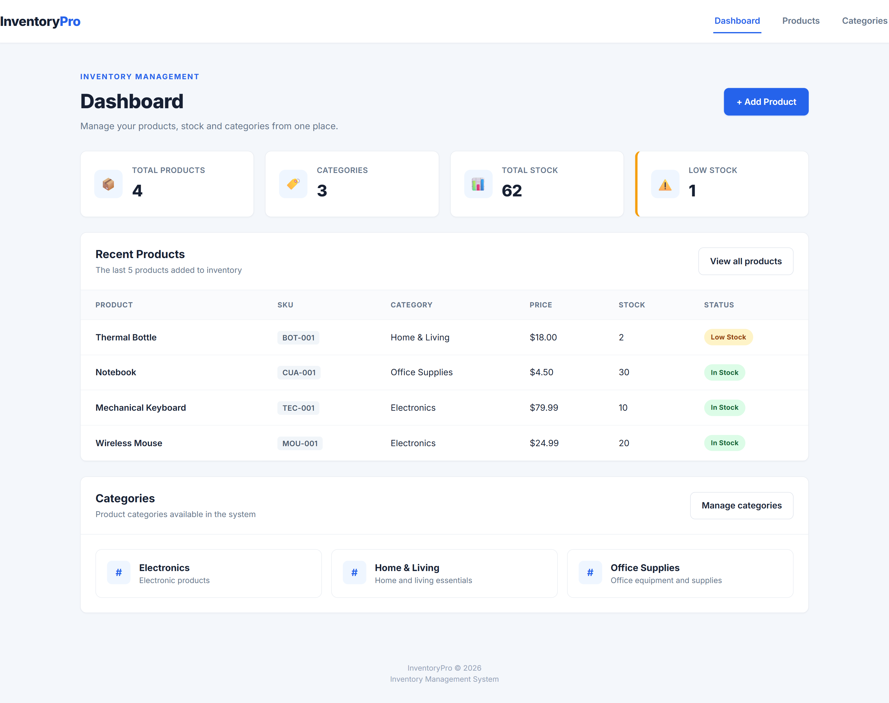
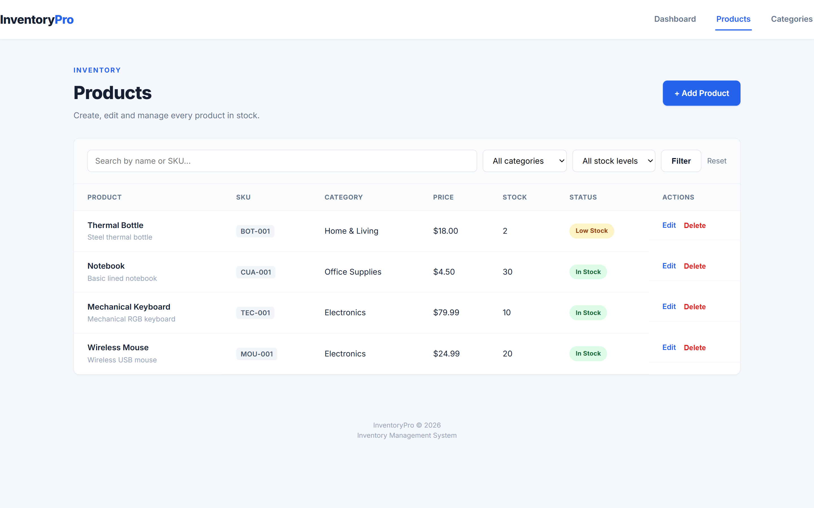
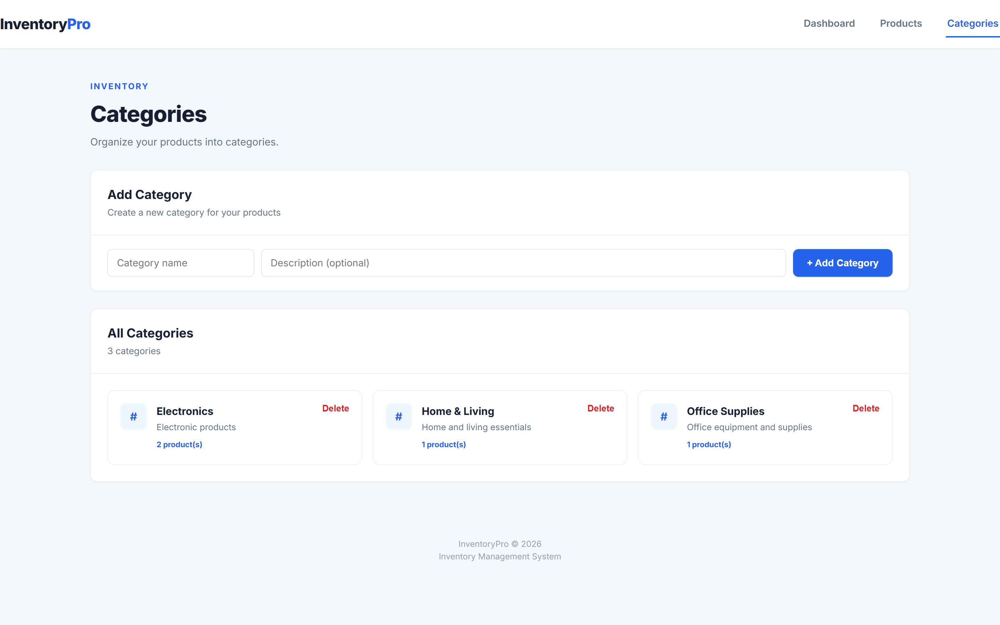

# InventoryPro — Inventory Management System

A lightweight, full-stack inventory management system built with **PHP (PDO)** and **MySQL**, no frameworks. Designed to demonstrate clean CRUD implementation, secure form handling and a professional, responsive UI.
## Screenshots

**Dashboard**


**Products**


**Categories**


## Features

- 📊 **Dashboard** with live stats: total products, categories, total stock and low-stock alerts
- 📦 **Product management**: create, edit, delete, search by name/SKU, filter by category and stock level
- 🏷️ **Category management**: create, delete, with product-count per category
- 🔒 **Security**: CSRF tokens on every form, prepared statements (PDO) on every query, server-side validation, output escaping (`htmlspecialchars`)
- ✅ **UX details**: flash messages after actions (PRG pattern), delete confirmations, low-stock badges, empty states
- 📱 Fully responsive layout

## Tech Stack

- PHP 8+ (vanilla, PDO for database access)
- MySQL / MariaDB
- HTML5, CSS3 (no frameworks), vanilla JavaScript

## Project Structure
inventory-management-system/
├── assets/
│ ├── css/
│ │ └── style.css # All styling, no frameworks
│ └── js/
│ └── app.js # Small UI enhancements (confirmations, etc.)
├── config/
│ └── database.php # PDO connection
├── database/
│ └── database.sql # Schema: categories + products tables
├── docs/
│ ├── screenshot-dashboard.png
│ ├── screenshot-products.png
│ └── screenshot-categories.png
├── includes/
│ ├── header.php # <head>, navbar, flash message rendering
│ ├── footer.php # Closing tags
│ └── helpers.php # Flash messages + CSRF helpers
├── index.php # Dashboard
├── products.php # Product list, search & filters
├── product_form.php # Add / edit product
├── product_delete.php # Handles product deletion (POST + CSRF only)
├── categories.php # Category list & create
├── category_delete.php # Handles category deletion (POST + CSRF only)
└── README.md


## Getting Started

### Requirements

- PHP 8.0+
- MySQL 5.7+ or MariaDB
- A local server environment (e.g. XAMPP, Laragon, or PHP's built-in server)

### Setup

1. **Clone the repository**

```bash
git clone https://github.com/your-username/inventory-management-system.git
cd inventory-management-system
```

2. **Create the database**

```bash
mysql -u root -p -e "CREATE DATABASE inventory_management"
mysql -u root -p inventory_management < database/database.sql
```

3. **Set your database credentials**

   By default the app connects as `root` with no password (typical for XAMPP/Laragon). If your local setup is different, set these environment variables before running it, or edit the defaults directly in `config/database.php`:

```
   DB_HOST=localhost
   DB_NAME=inventory_management
   DB_USER=root
   DB_PASS=
```

4. **Run it**

```bash
php -S localhost:8000
```

   Then open http://localhost:8000.

## Security Notes

This project follows a few practices deliberately, to demonstrate secure PHP habits even without a framework:

- All queries use **PDO prepared statements** — no raw string interpolation into SQL.
- Every state-changing form (create, update, delete) includes a **CSRF token**, verified with `hash_equals()`.
- All output is passed through `htmlspecialchars()` to prevent XSS.
- Deletes are **POST-only**, never triggered by a `GET` link.

## Possible Next Steps

- Pagination on the products table for larger inventories
- User authentication and role-based access (admin vs. staff)
- CSV export of the product list
- Stock movement history / audit log

## License

MIT — free to use for learning or as a starting point for your own project.